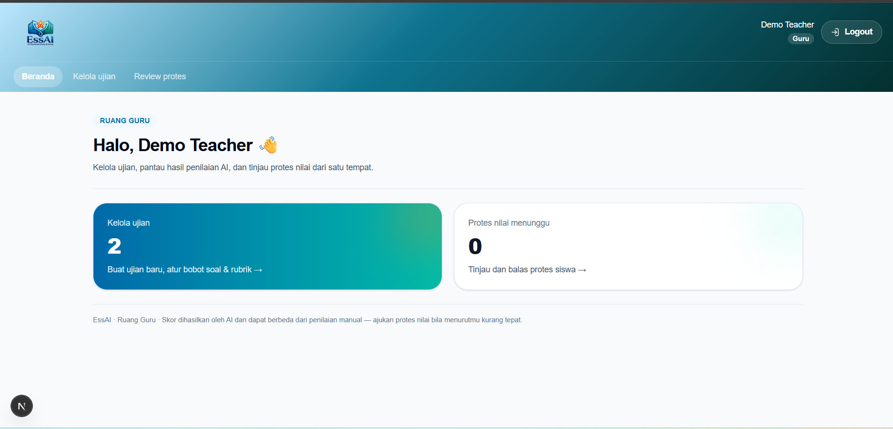
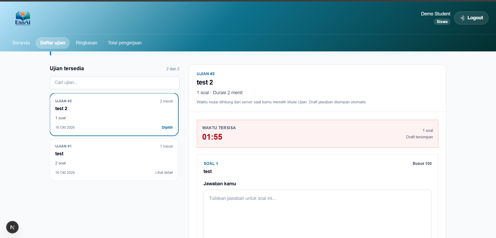
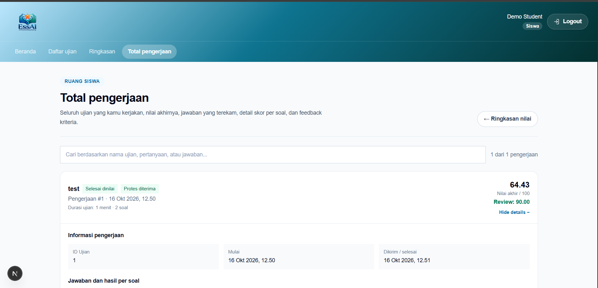

# EssAI — AI-Powered Essay Scoring

EssAI is a web platform that lets teachers build essay exams with weighted rubrics and lets students take those exams online. Every submitted answer is graded automatically by the Gemini LLM against the teacher's rubric criteria, producing a per-criterion score, reasoning, and a weighted final score. Students can review their results and file score protests; teachers can review and resolve those protests.

## Preview

| Teacher dashboard | Student exam attempt | Student result detail |
|---|---|---|
|  |  |  |

## Features

- **Teacher dashboard** — create exams with one or more questions, each with its own weight and rubric criteria; adjust question/criterion weights after creation.
- **Student exam flow** — timed attempts with server-side deadlines, answer autosave per question, and automatic submission when time runs out.
- **AI grading** — answers are graded against the rubric by Gemini, with automatic fallback across multiple models if one fails or is rate-limited.
- **Score history** — students can see a summary of all their results and drill into every attempt, including per-criterion feedback.
- **Score protests** — students can contest a grade; teachers review each protest and accept (with a revised score) or reject it with feedback.
- **Session-based auth** — email/password login with HTTP-only signed cookies and role-based access control (`teacher` / `student`).

## Tech stack

| Layer    | Technology |
|----------|------------|
| Frontend | Next.js 16 (App Router), React 19, TypeScript, Tailwind CSS 4 |
| Backend  | FastAPI, SQLAlchemy, Pydantic v2, PyJWT, pwdlib (Argon2) |
| Database | SQLite (file-based, via SQLAlchemy) |
| AI       | Google Gemini (`google-genai`) |

## Project structure

```
essay-scoring-project/
├── backend/
│   ├── app/
│   │   ├── routers/        # auth, exams, grading, history, protests
│   │   ├── services/       # llm_grader.py (Gemini), scoring.py (weighted score)
│   │   ├── models.py       # SQLAlchemy models
│   │   ├── schemas.py      # Pydantic request/response models
│   │   ├── security.py     # password hashing, JWT session cookies
│   │   ├── database.py     # SQLAlchemy engine/session
│   │   ├── seed_users.py   # creates the demo teacher/student accounts
│   │   └── main.py         # FastAPI app entrypoint
│   ├── tests/               # pytest test suite
│   ├── requirements.txt
│   └── .env.example
└── frontend/
    ├── app/                 # Next.js routes (login, student/*, teacher/*)
    ├── components/          # shared UI components
    ├── lib/api.ts           # typed API client for the backend
    └── package.json
```

## Prerequisites

- Python 3.11+
- Node.js 20+
- A [Google Gemini API key](https://aistudio.google.com/apikey)

## Setup

### 1. Backend

```bash
cd backend
python -m venv .venv
.venv\Scripts\activate        # Windows
# source .venv/bin/activate   # macOS/Linux

pip install -r requirements.txt

copy .env.example .env        # Windows
# cp .env.example .env        # macOS/Linux
```

Fill in `backend/.env`:

```
GEMINI_API_KEY=your_gemini_api_key
GEMINI_MODEL=gemini-3.8-flash
GEMINI_FALLBACK_MODELS=gemini-3.6-flash,gemini-3.5-flash-lite,gemini-3.1-flash-lite

APP_SECRET_KEY=a_long_random_string   # used to sign session cookies
APP_COOKIE_SECURE=false               # set to true when served over HTTPS

DEMO_TEACHER_NAME=Demo Teacher
DEMO_TEACHER_EMAIL=teacher@example.com
DEMO_TEACHER_PASSWORD=choose_a_password_12_chars_min

DEMO_STUDENT_NAME=Demo Student
DEMO_STUDENT_EMAIL=student@example.com
DEMO_STUDENT_PASSWORD=choose_a_password_12_chars_min
```

| Variable | Required | Default | Purpose |
|---|---|---|---|
| `GEMINI_API_KEY` | Yes | — | API key used to call the Gemini grading model. |
| `GEMINI_MODEL` | Yes | — | Primary Gemini model used for grading. |
| `GEMINI_FALLBACK_MODELS` | No | empty | Comma-separated models tried in order if the primary model fails or is rate-limited. |
| `APP_SECRET_KEY` | Yes | — | Signs the session cookie; must be a long random string, rotating it invalidates all sessions. |
| `APP_COOKIE_SECURE` | No | `false` | Set to `true` once the app is served over HTTPS, so the session cookie requires it. |
| `DEMO_TEACHER_NAME` / `DEMO_TEACHER_EMAIL` / `DEMO_TEACHER_PASSWORD` | Yes (for seeding) | — | Used once by `seed_users.py` to create the demo teacher account. Password must be ≥ 12 characters. |
| `DEMO_STUDENT_NAME` / `DEMO_STUDENT_EMAIL` / `DEMO_STUDENT_PASSWORD` | Yes (for seeding) | — | Used once by `seed_users.py` to create the demo student account. Password must be ≥ 12 characters. |

Frontend (`frontend/.env.local`, optional):

| Variable | Required | Default | Purpose |
|---|---|---|---|
| `NEXT_PUBLIC_API_URL` | No | `http://localhost:8000` | Base URL the frontend calls for the backend API. |

Create the database tables and seed the demo accounts:

```bash
python -m app.seed_users
```

This creates `backend/essay_scoring.db` (SQLite) and the two demo accounts above.

Start the API server:

```bash
uvicorn app.main:app --reload
```

The backend runs at `http://localhost:8000`.

### 2. Frontend

```bash
cd frontend
npm install
npm run dev
```

The app runs at `http://localhost:3000` and talks to the backend at `http://localhost:8000` by default. To point it elsewhere, set `NEXT_PUBLIC_API_URL` in a `frontend/.env.local` file.

### 3. Log in

Open `http://localhost:3000/login` and sign in with the demo teacher or student credentials you set in `backend/.env`. Teachers land on `/teacher` (manage exams, review protests); students land on `/student` (take exams, view history).

## API docs

With the backend running, FastAPI serves interactive API docs at `http://localhost:8000/docs` (Swagger UI) and `http://localhost:8000/redoc` — use these to explore every endpoint and try requests without reading the router source.

## Running tests

```bash
cd backend
pytest
```

## Deployment

This repo is set up for local development only; there's no Dockerfile or platform config yet. Before deploying, address:

- **CORS** — `backend/app/main.py` hardcodes `allow_origins` to `localhost:3000`/`127.0.0.1:3000`. Make it read the allowed origin(s) from an environment variable for the deployed frontend URL.
- **Database** — `backend/app/database.py` hardcodes a local SQLite file path. Most hosting platforms have an ephemeral filesystem, so data would be lost on redeploy/restart; point `SQLALCHEMY_DATABASE_URL` at a persistent database (e.g. managed Postgres) via an environment variable for production.
- **Secrets** — set `GEMINI_API_KEY`, `APP_SECRET_KEY`, and `APP_COOKIE_SECURE=true` as environment variables on the host; never commit `.env`.
- **Build** — frontend: `npm run build && npm start` (or deploy to Vercel); backend: run with a production ASGI setup, e.g. `uvicorn app.main:app --host 0.0.0.0 --port 8000` behind a reverse proxy, or `gunicorn -k uvicorn.workers.UvicornWorker app.main:app`.

## Troubleshooting

- **Port already in use** — something else is already on `3000` or `8000`; stop it or change the port (`npm run dev -- -p 3001`, `uvicorn app.main:app --port 8001` and update `NEXT_PUBLIC_API_URL` to match).
- **Login fails with "invalid credentials"** — make sure you ran `python -m app.seed_users` after filling in `backend/.env`, and that you're using the exact `DEMO_*_EMAIL`/`DEMO_*_PASSWORD` values from that file.
- **`seed_users.py` raises a validation error** — demo passwords must be at least 12 characters.
- **Grading fails or times out** — check `GEMINI_API_KEY` is valid and `GEMINI_MODEL` is a real model name; if you hit rate limits, set `GEMINI_FALLBACK_MODELS` so the backend retries with another model.
- **Frontend can't reach the backend** — confirm the backend is running on `http://localhost:8000` and, if you changed its port/host, that `NEXT_PUBLIC_API_URL` in `frontend/.env.local` matches.
- **Times look off by a few hours** — all timestamps are displayed in WIB (UTC+7) regardless of server/browser locale; this is intentional.

## Notes

- `backend/essay_scoring.db` and `.env` files are never committed (see `.gitignore`); each environment keeps its own.
- The demo passwords must be at least 12 characters — `seed_users.py` enforces this before creating accounts.

## License

No license file is currently included, which by default means all rights are reserved and others may not reuse this code. Add a `LICENSE` file (e.g. MIT, Apache-2.0) if you intend this project to be open source.
